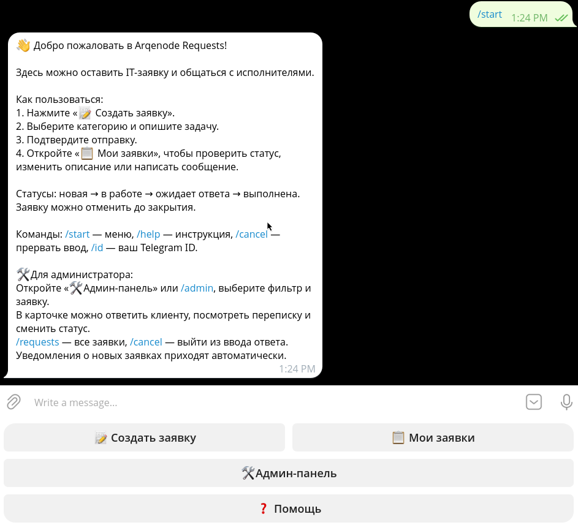
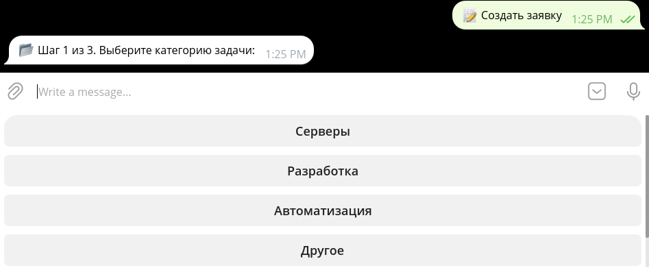
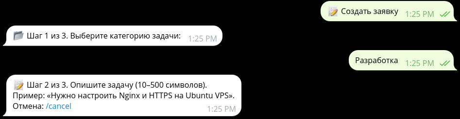
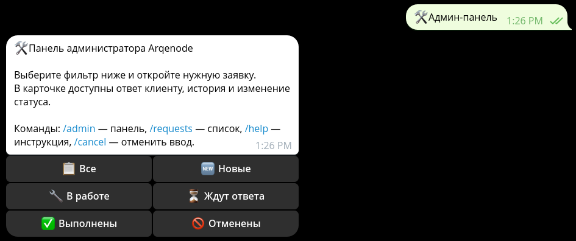

# Arqenode Request Bot

[](https://github.com/HroftKopf/arqenode-request-bot/actions/workflows/ci.yml)

Telegram Help Desk для приёма IT-заявок: клиент создаёт заявку, администратор
ведёт её по статусам и переписывается с клиентом. Проект показывает навыки
backend-разработки на Python: асинхронный Telegram-бот, SQLite с миграциями,
разграничение прав, rate limiting, тесты и CI.

## Возможности

**Клиент**

- создание заявки с выбором категории и подтверждением;
- список своих заявок, карточка со статусом и историей;
- редактирование категории/описания в разрешённых статусах;
- отмена заявки до закрытия;
- переписка с администратором и постраничная история.

**Администратор**

- `/admin`, `/requests` и фильтры по статусам;
- карточка заявки, ответ клиенту, история;
- разрешённые переходы статусов (`new → work → wait → done/cancel`);
- уведомления о новых заявках, ответах и смене статуса;
- журнал административных действий без текстов сообщений.

**Надёжность и безопасность**

- клиент видит только свои заявки; админ-доступ только у ID из `ADMIN_IDS`;
- rate limiting на операции, которые пишут в БД и рассылают уведомления;
- WAL, транзакции и версионируемые миграции SQLite (`PRAGMA user_version`);
- обработка 403/429/сетевых ошибок Telegram с ограниченными повторами;
- отсутствие токенов и текстов сообщений в логах.

## Технологический стек

| Слой | Технологии |
|---|---|
| Язык | Python 3.11+ |
| Telegram | aiogram 3.34 |
| БД | SQLite, aiosqlite 0.22 |
| Конфигурация | python-dotenv |
| Тесты | `unittest`, временная SQLite, Mock-объекты aiogram |
| Качество | `coverage.py`, Ruff |
| CI | GitHub Actions |


## Демонстрация интерфейса

### Главное меню
Клиентское меню для создания заявок, просмотра обращений и получения помощи.



### Создание заявки
Пошаговое создание обращения: выбор категории и описание задачи.





### Административная панель
Управление обращениями и фильтрация заявок по статусам.




## Требования к системе

- Python **3.11+** и `pip`;
- `venv` (или другой изолированный venv);
- Git;
- Linux, macOS или Windows (команды активации venv отличаются);
- токен Telegram-бота от [@BotFather](https://t.me/BotFather);
- один или несколько Telegram ID администраторов.

Внешняя БД, VPS и веб-сервер для polling-режима не требуются. SQLite идёт в
комплекте с Python.

## Установка и запуск

```bash
git clone https://github.com/HroftKopf/arqenode-request-bot.git
cd arqenode-request-bot

python -m venv .venv
source .venv/bin/activate        # Windows: .venv\Scripts\activate

python -m pip install --upgrade pip
python -m pip install -r requirements.txt

cp .env.example .env        # только если .env ещё нет
chmod 600 .env
# отредактируйте .env: BOT_TOKEN и ADMIN_IDS
```

Перед первым запуском обязательно заполните `.env`. Бот **не стартует** с
пустым/некорректным `BOT_TOKEN` или `ADMIN_IDS` и печатает понятную ошибку.

```bash
python main.py
```

Остановка — `Ctrl+C`. Каждому администратору нужно один раз открыть чат с
ботом и отправить `/start`, иначе Telegram может запретить доставку
уведомлений.

### Переменные окружения

| Переменная | Обязательна | Назначение |
|---|---|---|
| `BOT_TOKEN` | да | Токен от @BotFather. Не коммитится и не логируется |
| `ADMIN_IDS` | да | Положительные Telegram ID через запятую |
| `DATABASE_PATH` | нет | Путь к SQLite; относительный — от каталога проекта |
| `LOG_PATH` | нет | Путь к логу; по умолчанию `bot.log` |

Пример `.env` (значения-заглушки нужно заменить):

```ini
BOT_TOKEN=123456:YOUR_ACTUAL_TOKEN
ADMIN_IDS=PUT_YOUR_TELEGRAM_ID_HERE
# DATABASE_PATH=requests.db
# LOG_PATH=bot.log
```

Заглушки в `.env.example` намеренно невалидны, чтобы случайный запуск без
настройки не создал бота с чужими администраторами.

Для точного воспроизведения окружения можно использовать
`requirements.lock`:

```bash
python -m pip install -r requirements.lock
```

## Тестирование и покрытие

```bash
python -m pip install -r requirements-dev.txt
python -m unittest discover -s tests -v
coverage run -m unittest discover -s tests
coverage report -m
ruff check .
python -m compileall -q main.py config.py database.py helpers.py keyboards.py \
    models.py rate_limit.py states.py handlers tests
git diff --check
```

Тесты используют временную SQLite и Mock-объекты aiogram, **реальный Telegram
API не вызывается**. `coverage report` завершится с ошибкой при покрытии ниже
80% — порог задан в `pyproject.toml`.

Актуальная локальная проверка (2026-11-24, Python 3.14): **147 тестов, 0
провалов, 97.65% строк (998/1022), 98.24% ветвей (279/284)**. CI настроен на
Python 3.11; первый удалённый запуск появится во вкладке Actions после push.

### GitHub Actions

Workflow [`.github/workflows/ci.yml`](.github/workflows/ci.yml) запускается на
`push`/`pull_request` в `main` и вручную через `workflow_dispatch`. Он:

- ставит зависимости из `requirements.txt` и `requirements-dev.txt`;
- запускает `ruff check .`;
- компилирует модули через `compileall`;
- запускает `unittest` и `coverage` с порогом 80%.

Права workflow — только `contents: read`; реальные токены и Telegram ID не
нужны. Таймаут job — 15 минут.

## Безопасность и ограничения

- `.env`, `requests.db`, `bot.log` и `backups/` исключены из Git; рабочая БД и
  конфиг должны иметь права **600**:
  ```bash
  chmod 600 .env
  chmod 600 requests.db   # после первого запуска
  chmod 700 backups
  ```
- Не публикуйте токен, ID администраторов, содержимое заявок и скриншоты с
  реальными данными.
- Если `.env` или его копия могли покинуть машину — перевыпустите токен через
  @BotFather.
- `ADMIN_IDS` — обязательная настройка без значений по умолчанию; при ошибке
  бот завершается, а не открывает админку «кому попало».
- База не зашифрована: не храните в заявках пароли, токены и платёжные данные.
- FSM и rate limiting хранятся в памяти; после рестарта незавершённые диалоги и
  окна лимитов сбрасываются.
- Поддерживается один polling-процесс. Для нескольких воркеров нужны общий
  FSM-store и распределённый rate limiter.
- Для production рекомендуются systemd/healthcheck, регулярные проверенные
  бэкапы, политика хранения и мониторинг ошибок доставки.

## Архитектура проекта

```text
.
├── main.py                    # запуск polling, логирование, error handler
├── config.py                  # .env, обязательные настройки, пути
├── database.py                # SQLite, миграции, транзакции, CRUD, аудит
├── models.py                  # статусы, переходы, лимиты, категории
├── states.py                  # FSM-состояния aiogram
├── keyboards.py               # reply/inline-клавиатуры
├── helpers.py                 # форматирование, доставка, redraw, история
├── rate_limit.py              # in-memory rate limiter
├── handlers/
│   ├── common.py              # /start, /help, /id, /cancel
│   ├── client.py              # заявки и действия клиента
│   ├── admin.py               # админ-панель и статусы
│   └── dialogs.py             # переписка и история
├── tests/                     # 147 unit/integration-тестов на Mock-ботах
├── docs/SCREENSHOTS.md        # инструкция по скриншотам
├── .github/workflows/ci.yml   # GitHub Actions
├── pyproject.toml             # Ruff и coverage
├── requirements*.txt          # зависимости
└── README.md
```

Поток обработки: Telegram → `Dispatcher` → роутер (`common`/`client`/`admin`/
`dialogs`) → handler → `database.py` → SQLite; уведомления отправляются через
`helpers.py`. Callback-протокол: `u:*` для клиента, `a:*` для администратора.

### Данные и миграции

- Таблицы: `requests`, `request_messages`, `admin_actions`.
- Схема версионируется через `PRAGMA user_version` (текущая версия — 3).
- v1 → v2: русские статусы мигрируют в коды `new/work/wait/done/cancel`,
  добавляется CHECK и WAL; v2 → v3: журнал `admin_actions`.
- `admin_actions` хранит `admin_id`, операцию (`status_change`/`reply`),
  `request_id`, переход статусов и время; текстов сообщений там нет.
- История использует снимок `max_id`, поэтому новые сообщения не сдвигают
  страницы; длинные сообщения помечаются как обрезанные.

### Резервная копия

Остановите бота и выполните:

```bash
umask 077
STAMP="$(date -u +%Y%m%dT%H%M%SZ)"
mkdir -p "backups/$STAMP"
chmod 700 backups "backups/$STAMP"
cp -p .env "backups/$STAMP/.env"
chmod 600 "backups/$STAMP/.env"
STAMP="$STAMP" python - <<'PY'
import os
import sqlite3
from pathlib import Path
backup = Path('backups') / os.environ['STAMP'] / 'requests.db'
src = sqlite3.connect('requests.db')
dst = sqlite3.connect(backup)
with dst:
    src.backup(dst)
src.close(); dst.close()
PY
```

Не используйте `cp` для работающей SQLite-базы в режиме WAL: копируйте через
`sqlite3.Connection.backup` или после остановки бота.

### Проверка совместимости со старой базой

Перед первым запуском новой версии:

```bash
cp requests.db /tmp/requests-check.db
DATABASE_PATH=/tmp/requests-check.db python -c \
  "import asyncio, database; asyncio.run(database.init_db())"
sqlite3 /tmp/requests-check.db "PRAGMA user_version; PRAGMA integrity_check;"
```

Ожидается версия `3` и `ok`; количество заявок и сообщений не должно измениться.

## Документация

- [CHANGELOG.md](CHANGELOG.md) — журнал изменений.
- [REMEDIATION_REPORT.md](REMEDIATION_REPORT.md) — технический аудит и
  обоснование архитектурных решений.
- [CI_IMPLEMENTATION_REPORT.md](CI_IMPLEMENTATION_REPORT.md) — отчёт о
  настройке CI, README и проверке безопасности публикации.
- [docs/SCREENSHOTS.md](docs/SCREENSHOTS.md) — как подготовить скриншоты.

## Статусы и лимиты

| Код | Статус | Кому доступен |
|---|---|---|
| `new` | Новая | клиент: редактирование/отмена; админ: все действия |
| `work` | В работе | клиент: ответ/отмена; админ: `wait`/`done`/`cancel` |
| `wait` | Ожидает ответа | клиент: редактирование/ответ/отмена; админ: `work`/`done`/`cancel` |
| `done` | Выполнена | терминальный |
| `cancel` | Отменена | терминальный |

- Ответ клиента в статусе «Ожидает ответа» переводит заявку в «В работе».
- Обратные переходы (`В работе → Новая`) и изменения терминальных заявок
  запрещены.
- Лимиты: создание — 3/час, сообщение — 10/мин, редактирование — 5/10 мин,
  отмена — 5/10 мин, смена статуса админом — 30/мин.
- Лимиты in-memory и сбрасываются при рестарте; при превышении пользователь
  видит время повтора.
